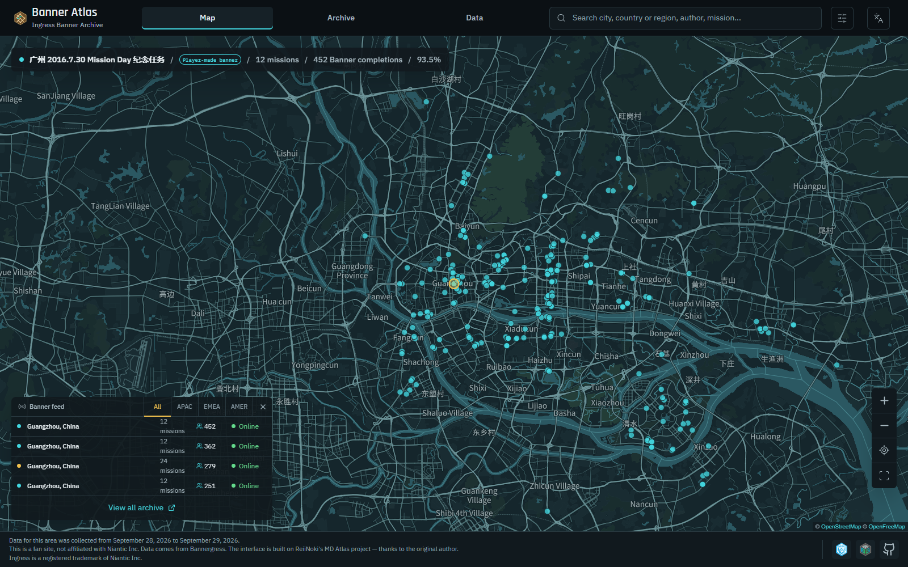
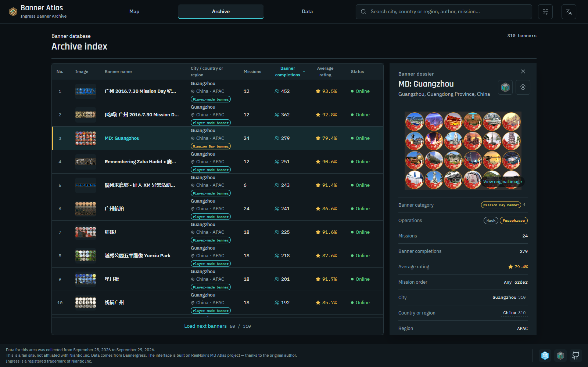
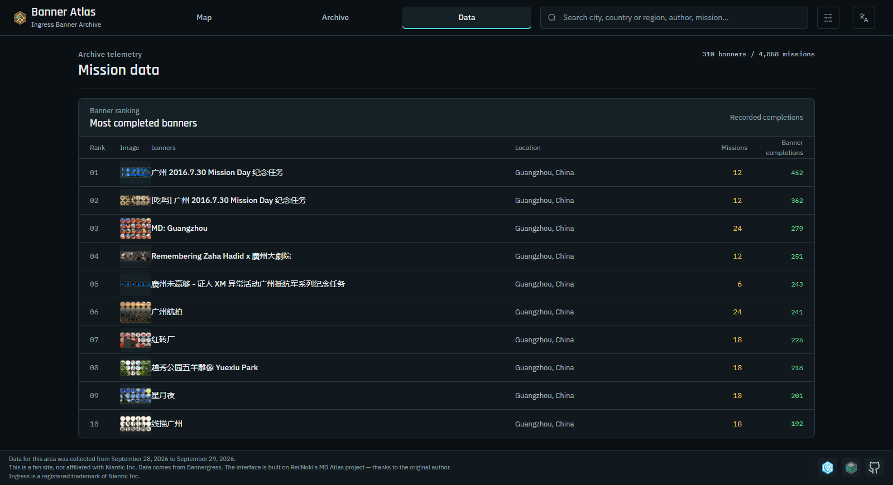
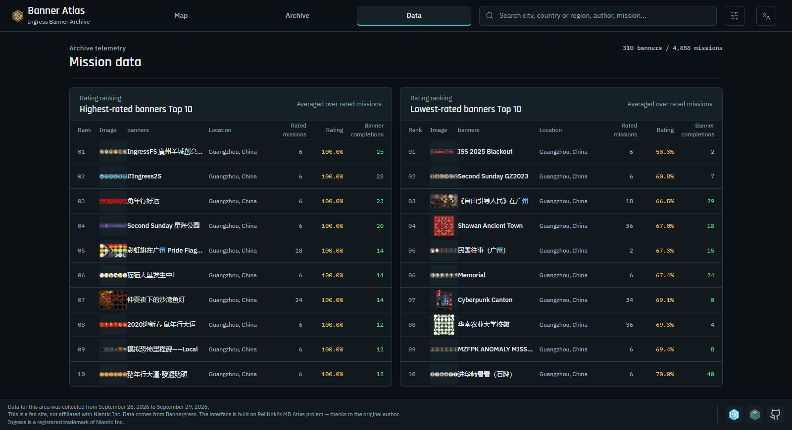

# Banner Atlas

**简体中文** · [English](README_EN.md) · [日本語](README_JA.md)

**Ingress 拼图（banner）任务档案 · 可在本地运行的开源版本**

## 项目简介

Banner Atlas 把 [Bannergress](https://bannergress.com/) 上的 Ingress 拼图整理成可检索、可筛选的档案：拼图标题、类型、规模、作者阵营、评分、完成次数、路线距离与用时，以及每个拼图包含的任务明细。

本项目由 **⚠AI Agent⚠** 在 [MD Atlas](https://github.com/ReiiNoki/md-atlas) 项目的基础上改造而来。原项目面向 Ingress Mission Day 活动档案；本项目把数据模型与界面调整为适配**任意拼图**（Mission Day 拼图与玩家自制拼图）。

## 运行方式：仅本地

**本仓库只提供本地开发与预览，不包含任何云端托管配置。** 仓库中已移除原项目的 Cloudflare Workers / Pages 相关内容（`wrangler` 配置、部署脚本、`_headers` 缓存规则等），也不提供线上实例。

如果你需要部署，请自行选择托管平台，并按该平台的要求补充配置；本项目不对此提供支持。

### 环境要求

- Node.js **22 或更高版本**
- npm（随 Node.js 提供）

### 启动开发服务器

```bash
git clone https://github.com/cantonres/ingress-banner-atlas.git
cd ingress-banner-atlas
npm ci
npm run dev
```

终端会输出本地地址（默认 `http://127.0.0.1:5173/`），在浏览器中打开即可。

### 构建与本地预览

```bash
npm run build     # 产物输出到 dist/
npm run preview   # 以本地静态服务器预览 dist/
```

### 常用命令

| 命令 | 说明 |
|---|---|
| `npm run dev` | 启动 Vite 开发服务器 |
| `npm run build` | 生产构建，输出到 `dist/` |
| `npm run preview` | 预览已构建的产物 |
| `npm test` | 运行 Node 原生测试（`tests-js/`） |
| `npm run lint` | ESLint 检查 |
| `npm run check` | lint + test + build 全套校验 |
| `npm run test:browser` | 可选的 Chromium 冒烟测试，需本机有 Chrome，可通过 `CHROME_PATH` 指定路径 |

## 功能

- **地图**：按地理位置浏览拼图起点，支持缩放、定位与筛选联动。
- **档案**：按拼图类型（Mission Day / 玩家自制）、规模档位、国家或地区、作者阵营、在线状态筛选，支持标题与城市搜索。
- **数据**：规模分布、国家与地区分布、作者阵营分布，以及完成次数与评分的排行。
- **详情**：单个拼图的任务清单、评分、完成次数、距离、用时、portal 操作类型与来源链接。

界面提供中文、英文、日文三种语言，并适配桌面与移动设备。

## 样例数据

为了保持仓库轻量，`public/data/` 只收录**一个城市**的样例数据：

- **Windermere（英国）**：2 个拼图、12 个任务；一个在线、一个已离线。

样例数据的用途是让站点完整启动、并走通地图、档案、数据与详情四个视图，**不代表真实档案的规模、分布或统计结论**。其中部分字段（评分、完成次数等）来自一份历史快照，属于既有数据内容；本仓库不提供生成或复现这些字段的脚本，也不提供任何完整档案数据。要构建自己的档案，请按下一节的方式自行采集公开数据。

## 界面预览

以下截图为英文界面，使用**临时演示数据**（广州 310 个拼图、4,858 个任务）渲染，仅用于展示数据较饱满时的界面效果。**该演示数据不随本仓库发布**；仓库内 `public/data/` 仍只有上文所述的 Windermere 样例。截图中的拼图标题、作者名等元信息来自 Bannergress 公开 API，评分、完成次数等来自 Ingress Intel Map 的会话内数据；两者均为历史快照内容。



*地图视图：全部拼图的地理位置分布。*



*档案视图：拼图索引列表与右侧详情面板。*



*数据视图：完成人数最多的拼图排行。*



*数据视图：评分最高与最低的拼图排行。*


## 数据采集（仅限公开 API）

`tools/` 中提供一个脚本：

| 脚本 | 作用 |
|---|---|
| `tools/01-fetch-public.mjs` | 调用 Bannergress 公开 API，抓取指定地点的拼图与任务，输出到 `out/`（已在 `.gitignore` 中排除） |

脚本无需登录，只访问公开接口；参数与用法见文件顶部注释。`bg-openapi.json` 是 Bannergress 的 OpenAPI 描述，用于核对接口字段。

**本仓库不提供任何针对 Ingress Intel Map 的数据采集脚本，也不鼓励这样做**：这类采集可能违反该服务的使用条款。评分、完成次数等会话内字段不在本项目的采集范围内；样例数据中出现的这类字段仅为历史快照内容，不构成对其获取方式的背书。合并、补全与生成 `public/data/` 的流程同样不在本仓库内，使用者若有需要须自行实现并自行承担合规责任。

## 数据来源与说明

本项目的采集脚本只调用 [Bannergress](https://bannergress.com/) 的公开 API；界面展示的是采集时点的快照，而非实时数据。

- **档案不是实时数据**：拼图状态、评分与完成次数可能已经变化。
- **历史记录可能存在缺失**：未收录的拼图不代表不存在，缺少某项任务数据也不代表该任务不存在。
- **距离与用时仅供参考**：它们不等于实际步行路线长度或每位玩家的完成时间。
- **评分榜单**按当前筛选范围计算；空值与 0 值不参与排名，同分时优先排列完成次数更多的条目。
- **榜单并非推荐结论**：未设置最低完成次数门槛，完成次数也不等于评价人数。

原始拼图与任务名称尽量保留来源文本，中文地名用于辅助浏览和搜索。

## 未来拓展

以下是两个尚未实现、但适合在本项目基础上继续探索的方向：

- **拼图图片标签诊断**：以拼图封面图为样本做无监督聚类或图像分类，辅助自动打标签并校验现有分类的一致性。
- **城市拼图任务排行榜**：把档案中各城市拼图任务的完成数与评分整理成排行榜对外发布。

## 技术栈

React 19 · Vite 6 · MapLibre GL · 原生 Node 测试 · ESLint

## 致谢

- **[MD Atlas](https://github.com/ReiiNoki/md-atlas)**：本项目的代码基础，MIT 许可，作者 ReiiNoki。
- **[Bannergress](https://bannergress.com/)**：拼图与任务数据的来源。
- **[OpenFreeMap](https://openfreemap.org/)** / **[OpenStreetMap](https://www.openstreetmap.org/)**：地图服务与地图数据。

## 声明与许可

Banner Atlas 是爱好者维护的非官方工具，与 Niantic Inc. 无官方关联。Ingress 是 Niantic Inc. 的注册商标。

本项目以 [MIT 许可](LICENSE) 发布。原始代码版权归 ReiiNoki 所有，改造部分版权归 Choujingress 所有。
