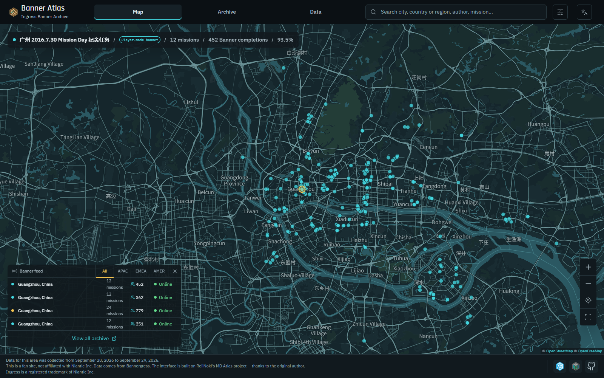
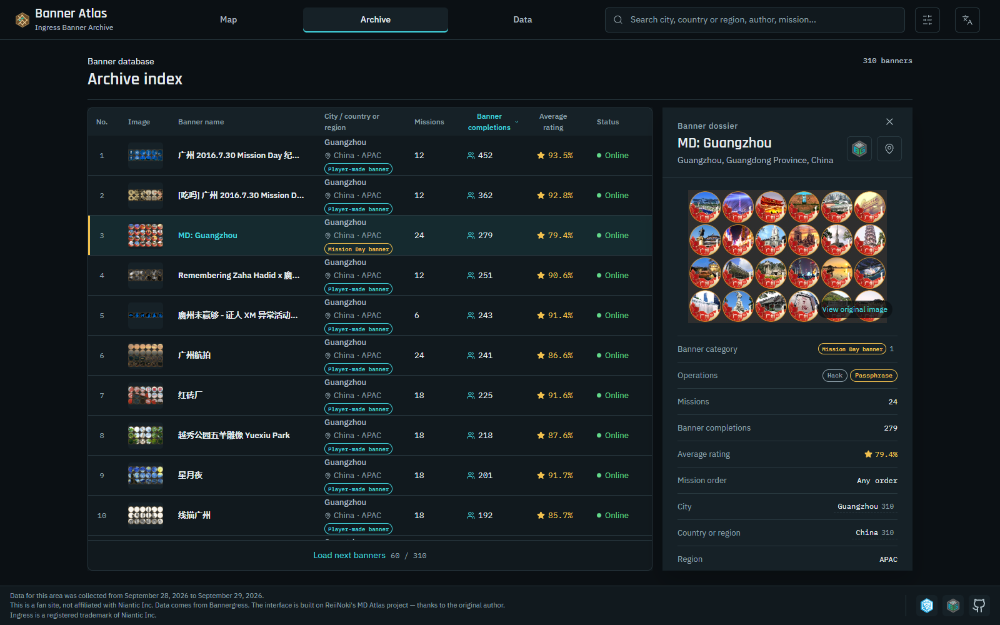
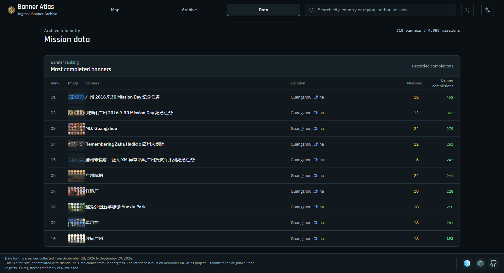
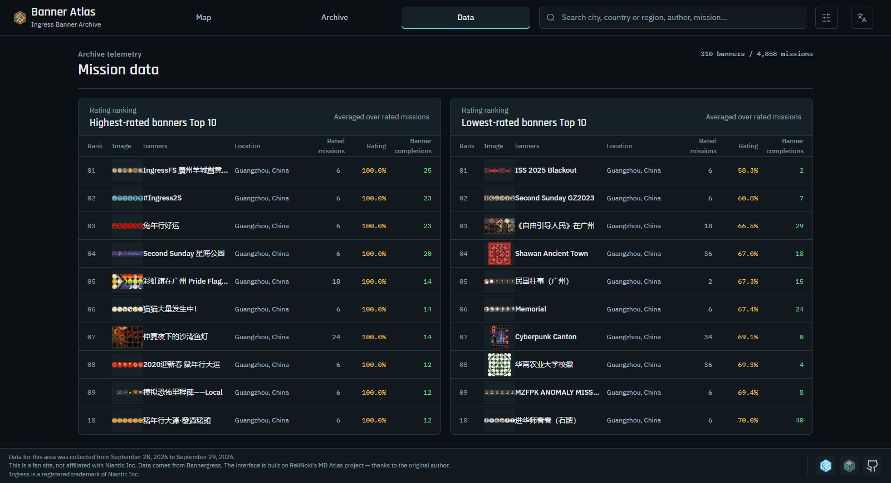

# Banner Atlas

[简体中文](README.md) · **English** · [日本語](README_JA.md)

**An archive of Ingress banners (mission banners) · open-source, local-first**

## Overview

Banner Atlas turns Ingress banners listed on [Bannergress](https://bannergress.com/) into a browsable, filterable archive: banner title, category, size, author faction, rating, completions, route length and duration, plus the mission breakdown of every banner.

The project is a derivative of [MD Atlas](https://github.com/ReiiNoki/md-atlas). The original was an archive of Ingress Mission Day events; this version reworks the data model and interface to support **any banner** (Mission Day banners and player-made banners) and ships a single collector built on the public Bannergress API.

## Local use only

**This repository is meant to be run locally. It contains no hosting configuration.** Everything Cloudflare Workers / Pages related from the upstream project (the `wrangler` configuration, deploy scripts, `_headers` cache rules) has been removed, and no hosted instance is provided.

If you want to deploy it, choose a hosting platform yourself and add whatever configuration that platform requires. This project offers no support for deployment.

### Requirements

- Node.js **22 or newer**
- npm (bundled with Node.js)

### Start the development server

```bash
git clone https://github.com/Choujingress/ingress-banner-atlas.git
cd ingress-banner-atlas
npm ci
npm run dev
```

The terminal prints the local address (by default `http://127.0.0.1:5173/`). Open it in a browser.

### Build and preview locally

```bash
npm run build     # output goes to dist/
npm run preview   # serve dist/ with a local static server
```

### Scripts

| Command | Purpose |
|---|---|
| `npm run dev` | Start the Vite dev server |
| `npm run build` | Production build into `dist/` |
| `npm run preview` | Preview the built output |
| `npm test` | Run the Node test suite (`tests-js/`) |
| `npm run lint` | ESLint |
| `npm run check` | lint + test + build |
| `npm run test:browser` | Optional Chromium smoke test; needs a local Chrome, configurable via `CHROME_PATH` |

## Features

- **Map**: browse banner start points geographically, with zoom, geolocation and filter synchronisation.
- **Archive**: filter by banner category (Mission Day / player-made), size tier, country or region, author faction and availability; search by title and city.
- **Data**: size distribution, country and region distribution, author faction split, and completion / rating rankings.
- **Detail**: mission list, rating, completions, distance, duration, portal objectives and source links for a single banner.

The interface is available in Chinese, English and Japanese, and adapts to desktop and mobile.

## Sample data

To keep the repository small, `public/data/` contains the data of **one city** only:

- **Windermere (United Kingdom)**: 2 banners, 12 missions; one online, one offline.

The sample exists so the site boots and every view (map, archive, data, detail) can be exercised. It **does not represent the scale, distribution or statistical conclusions of a real archive**. Some fields in it (ratings, completion counts) come from a historical snapshot and are simply part of that snapshot; this repository ships no script that generates or reproduces them, and ships no full dataset. To build your own archive, collect public data as described below.

## Interface preview

The screenshots below show the English interface rendered with **temporary demo data** (310 banners, 4,858 missions from Guangzhou), used only to illustrate the interface with a fuller dataset. **This demo data is not shipped with the repository**; `public/data/` still contains only the Windermere sample described above. Banner titles and agent names in the screenshots come from the public Bannergress API, while ratings and completion counts come from session-scoped Ingress Intel Map data; both are part of a historical snapshot.



*Map view: geographic distribution of all banners.*



*Archive view: banner index and the detail panel.*



*Data view: most completed banners ranking.*



*Data view: highest-rated and lowest-rated banners.*


## Data collection (public API only)

`tools/` contains exactly one script:

| Script | Purpose |
|---|---|
| `tools/01-fetch-public.mjs` | Query the public Bannergress API for the banners and missions of a given place and write the result to `out/` (excluded by `.gitignore`) |

No login is required and only public endpoints are called; see the header comments for arguments and usage. `bg-openapi.json` is the Bannergress OpenAPI description, kept for field reference.

**This repository ships no collector that targets the Ingress Intel Map, and does not encourage one**: such collection may violate that service's terms of use. Session-scoped fields such as ratings and completion counts are outside the scope of this project; their presence in the sample data is only a historical snapshot and is not an endorsement of any method used to obtain them. The merge, enrichment and `public/data/` generation steps are likewise not included here — anyone who needs them must implement them independently and take responsibility for compliance.

## Data notes

The collector calls only the public [Bannergress](https://bannergress.com/) API, and the interface shows a snapshot taken at collection time rather than live data.

- **The archive is not live**: banner status, ratings and completion counts may have changed.
- **Records may be incomplete**: a missing banner does not mean it never existed, and missing mission data does not mean the mission does not exist.
- **Distance and duration are indicative**: they are not the walking distance of a route nor any individual player's completion time.
- **Rankings** are computed within the current filter scope; null and zero values are excluded, and ties are broken by completion count.
- **Rankings are not recommendations**: there is no minimum-completion threshold, and completion count is not the number of reviewers.

Banner and mission titles keep their source text where possible; Chinese place names are provided to aid browsing and search.

## Possible future work

Two directions that are not implemented yet, but fit naturally on top of this project:

- **Image-based label diagnostics**: cluster or classify banner cover images to suggest labels and audit the consistency of existing categories.
- **City-level mission leaderboards**: publish per-city rankings of mission completion counts and ratings drawn from the archive.

## Stack

React 19 · Vite 6 · MapLibre GL · Node's built-in test runner · ESLint

## Credits

- **[MD Atlas](https://github.com/ReiiNoki/md-atlas)**: the code base this project derives from, MIT licensed, by ReiiNoki.
- **[Bannergress](https://bannergress.com/)**: source of banner and mission data.
- **[OpenFreeMap](https://openfreemap.org/)** / **[OpenStreetMap](https://www.openstreetmap.org/)**: map service and map data.

## Notice and licence

Banner Atlas is an unofficial fan project with no affiliation to Niantic Inc. Ingress is a registered trademark of Niantic Inc.

Released under the [MIT licence](LICENSE). The original code is copyright ReiiNoki; modifications are copyright Choujingress.
