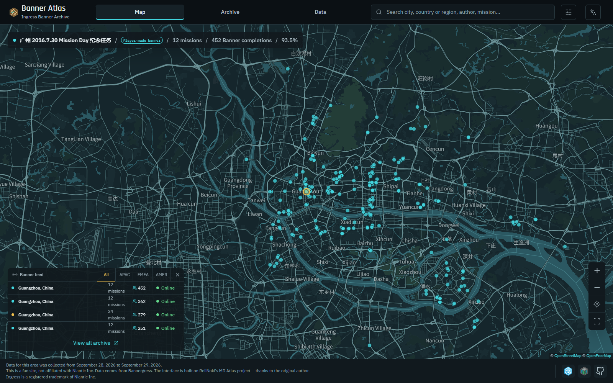
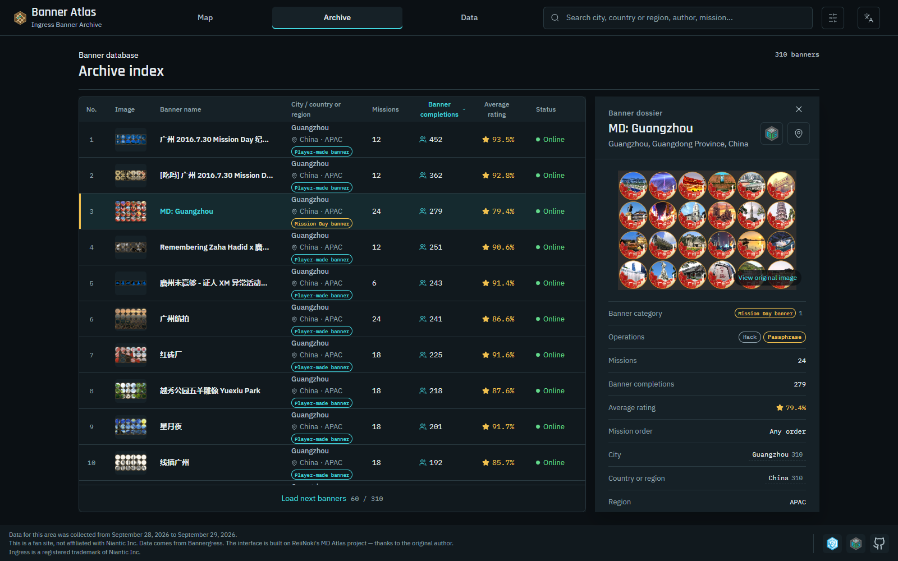
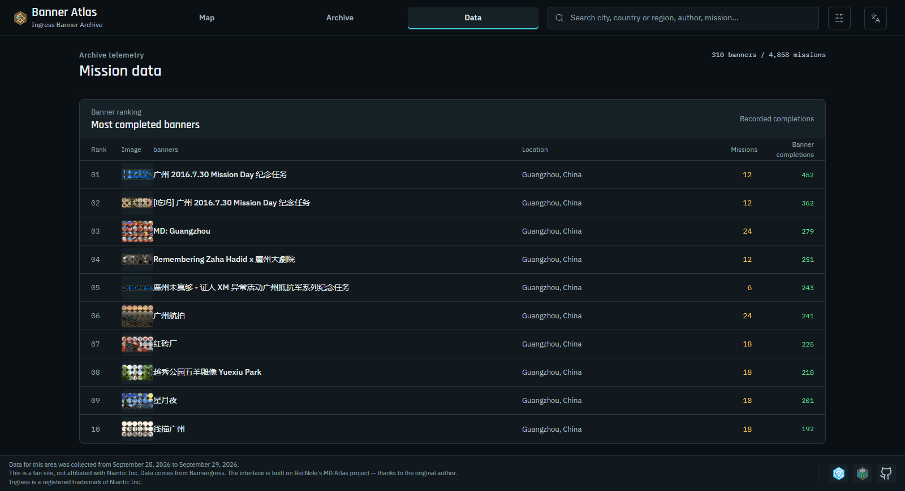
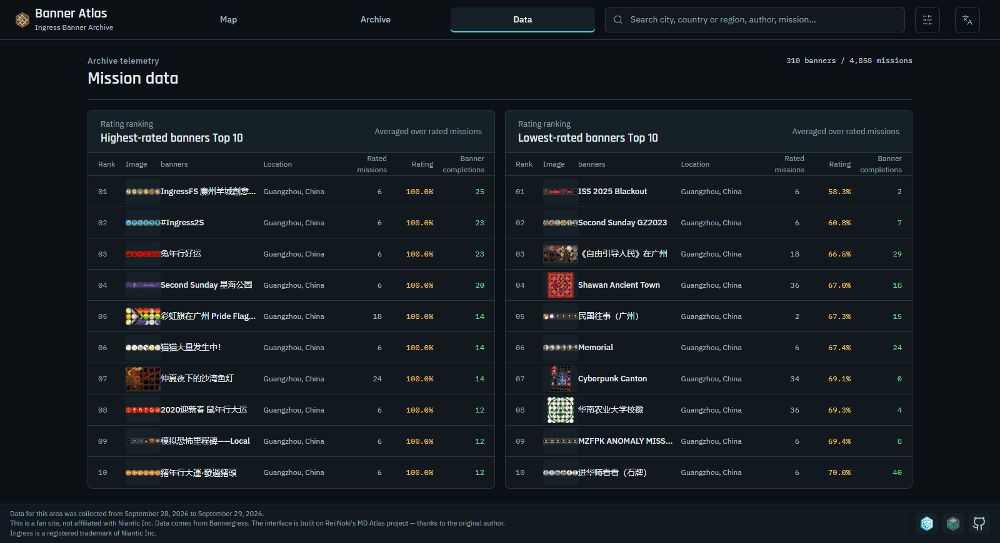

# Banner Atlas

[简体中文](README.md) · [English](README_EN.md) · **日本語**

**Ingress バナー（ミッション・バナー）のアーカイブ · ローカル実行前提のオープンソース版**

## 概要

Banner Atlas は、[Bannergress](https://bannergress.com/) に登録されている Ingress のバナーを、検索・絞り込みできるアーカイブにまとめたものです。バナーのタイトル、種類、規模、作者の陣営、評価、完了回数、ルート距離と所要時間、そして各バナーに含まれるミッションの内訳を記録します。

本プロジェクトは [MD Atlas](https://github.com/ReiiNoki/md-atlas) を改修したものです。元のプロジェクトは Ingress Mission Day のイベント・アーカイブでしたが、本版ではデータモデルと画面を**任意のバナー**（Mission Day バナーとプレイヤー制作バナー）に対応させ、Bannergress の公開 API を用いた収集スクリプトを 1 つ同梱しています。

## ローカル実行のみ

**本リポジトリはローカルでの実行を前提としており、ホスティング用の設定を一切含みません。** 上流プロジェクトにあった Cloudflare Workers / Pages 関連の構成（`wrangler` 設定、デプロイ用スクリプト、`_headers` のキャッシュ規則など）は削除済みで、公開インスタンスも提供していません。

デプロイしたい場合は、利用するホスティングサービスを自分で選び、そのサービスに必要な設定を追加してください。本プロジェクトはデプロイについてサポートしません。

### 動作環境

- Node.js **22 以上**
- npm（Node.js に同梱）

### 開発サーバーの起動

```bash
git clone https://github.com/Choujingress/ingress-banner-atlas.git
cd ingress-banner-atlas
npm ci
npm run dev
```

ターミナルにローカルアドレス（既定では `http://127.0.0.1:5173/`）が表示されるので、ブラウザで開きます。

### ビルドとローカルプレビュー

```bash
npm run build     # 出力は dist/ に生成
npm run preview   # dist/ をローカルの静的サーバーで確認
```

### コマンド一覧

| コマンド | 内容 |
|---|---|
| `npm run dev` | Vite 開発サーバーを起動 |
| `npm run build` | 本番ビルド（`dist/`） |
| `npm run preview` | ビルド成果物をプレビュー |
| `npm test` | Node 標準テスト（`tests-js/`）を実行 |
| `npm run lint` | ESLint |
| `npm run check` | lint + test + build |
| `npm run test:browser` | 任意の Chromium スモークテスト。ローカルの Chrome が必要で、`CHROME_PATH` で指定可能 |

## 機能

- **地図**：バナーの開始地点を地理的に閲覧。ズーム、現在地、フィルター連動に対応。
- **アーカイブ**：バナーの種類（Mission Day / プレイヤー制作）、規模、国・地域、作者の陣営、公開状況で絞り込み。タイトルと都市名で検索できます。
- **データ**：規模の分布、国・地域の分布、作者陣営の内訳、完了回数と評価のランキング。
- **詳細**：1 つのバナーについて、ミッション一覧、評価、完了回数、距離、所要時間、ポータル操作の種類、出典リンクを表示。

画面は中国語・英語・日本語に対応し、デスクトップとモバイルの両方に最適化しています。

## サンプルデータ

リポジトリを軽量に保つため、`public/data/` には**1 都市分**のサンプルのみを収録しています。

- **Windermere（イギリス）**：バナー 2 件、ミッション 12 件。1 件は公開中、1 件はオフライン。

サンプルはサイトを起動し、地図・アーカイブ・データ・詳細の全画面を確認するためのもので、**実際のアーカイブの規模・分布・統計的結論を示すものではありません**。評価や完了回数などの一部フィールドは過去のスナップショットに含まれていた値であり、本リポジトリはそれらを生成・再現するスクリプトも、完全なデータセットも提供しません。独自のアーカイブを作る場合は、次節の方法で公開データを収集してください。

## 画面プレビュー

以下のスクリーンショットは英語インターフェースを**一時的なデモデータ**（広州のバナー 310 件、ミッション 4,858 件）で描画したもので、データが充実した状態の画面を示すためだけに使用しています。**このデモデータは本リポジトリには同梱されません**。`public/data/` には前述の Windermere サンプルのみが含まれます。スクリーンショットのバナー名・エージェント名などは Bannergress の公開 API に、評価・完了回数などは Ingress Intel Map のセッション内データに由来します。いずれも過去のスナップショットの一部です。



*地図ビュー：全バナーの地理的な位置分布。*



*アーカイブビュー：バナー索引と詳細パネル。*



*データビュー：完走者数が多いバナーのランキング。*



*データビュー：評価が最も高いバナーと最も低いバナーのランキング。*


## データ収集（公開 API のみ）

`tools/` に含まれるスクリプトは 1 つだけです。

| スクリプト | 役割 |
|---|---|
| `tools/01-fetch-public.mjs` | Bannergress の公開 API から指定地点のバナーとミッションを取得し、`out/` に出力（`.gitignore` で除外済み） |

ログインは不要で、公開エンドポイントのみにアクセスします。引数と使い方はファイル冒頭のコメントを参照してください。`bg-openapi.json` は Bannergress の OpenAPI 記述で、フィールド確認用に同梱しています。

**本リポジトリは Ingress Intel Map を対象とする収集スクリプトを一切提供せず、その実施も推奨しません**。そのような収集は同サービスの利用規約に抵触する可能性があります。評価・完了回数などのセッション内フィールドは本プロジェクトの収集範囲外であり、サンプルデータに含まれる値は過去のスナップショットの一部にすぎず、取得手段を推奨するものではありません。統合・補完・`public/data/` 生成の工程も本リポジトリには含まれず、必要な場合は利用者自身が実装し、コンプライアンス上の責任を負うものとします。

## データについて

収集スクリプトが呼び出すのは [Bannergress](https://bannergress.com/) の公開 API のみで、画面に表示されるのは収集時点のスナップショットであり、リアルタイムデータではありません。

- **リアルタイムではありません**：バナーの状態・評価・完了回数は変化している可能性があります。
- **記録は不完全な場合があります**：未収録のバナーが存在しないとは限らず、ミッション情報の欠落もミッションの不在を意味しません。
- **距離と所要時間は目安です**：実際の徒歩ルート長や各プレイヤーの所要時間ではありません。
- **ランキング**は現在の絞り込み範囲で算出します。null と 0 は除外し、同点の場合は完了回数が多い順に並べます。
- **ランキングは推奨ではありません**：最低完了回数のしきい値は設けておらず、完了回数は評価者数でもありません。

バナー名とミッション名はできる限り出典の表記を保ち、中国語の地名は閲覧と検索の補助として用いています。

## 今後の拡張

未実装ですが、本プロジェクトの基盤の上で検討しやすい 2 つの方向性です。

- **画像によるラベル診断**：バナーのカバー画像を非監視クラスタリングまたは画像分類にかけ、ラベル付与と既存分類の整合性検証を支援する。
- **都市別ミッションランキング**：アーカイブ内の各都市について、ミッションの完了数と評価のランキングをまとめて公開する。

## 技術スタック

React 19 · Vite 6 · MapLibre GL · Node 標準テストランナー · ESLint

## 謝辞

- **[MD Atlas](https://github.com/ReiiNoki/md-atlas)**：本プロジェクトのコードベース（MIT ライセンス、作者 ReiiNoki）。
- **[Bannergress](https://bannergress.com/)**：バナーとミッションデータの出典。
- **[OpenFreeMap](https://openfreemap.org/)** / **[OpenStreetMap](https://www.openstreetmap.org/)**：地図サービスと地図データ。

## 注意事項とライセンス

Banner Atlas はファンによる非公式プロジェクトであり、Niantic Inc. とは関係ありません。Ingress は Niantic Inc. の登録商標です。

[MIT ライセンス](LICENSE) で公開しています。元のコードの著作権は ReiiNoki に、改修部分の著作権は Choujingress に帰属します。
